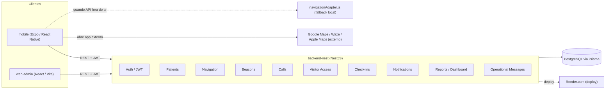

# Arquitetura do Sistema — Visão Geral

> Este documento é a visão de alto nível (camadas, componentes, implantação). Para o **pipeline de navegação/acesso/beacon** passo a passo, ver `docs/ARCHITECTURE.md`. Para contratos de endpoint, ver `docs/API.md`. Para o modelo de dados, ver `docs/banco_dados.md`.

## 1. Monorepo

```
navora/
├── mobile/        Expo (React Native) — app do paciente/visitante
├── backend-nest/  NestJS + Prisma + PostgreSQL — API única
├── web-admin/     React + Vite — painel de recepção/admin
└── docs/          documentação (este diretório)
```

Não há `backend/` ativo — existia um backend FastAPI legado, mas `backend-nest/` é a única fonte de verdade dos contratos hoje (ver `docs/ARCHITECTURE.md`).

## 2. Diagrama de componentes



## 3. Stack por componente

| Componente | Stack | Observações |
|---|---|---|
| `mobile` | Expo SDK 57, React Native 0.86.3, sem React Navigation | Navegação por **state machine própria** em `App.js` (`screens` object + `screenStack`/`navigate`/`goBack`), não pilha de rotas do React Navigation. |
| `backend-nest` | NestJS, Prisma Client, PostgreSQL, `class-validator`, `@nestjs/jwt`, `bcryptjs`, `helmet`, `@nestjs/throttler` (local) | Módulos por domínio (`auth`, `patients`, `navigation`, `beacons`, `calls`, `visitor-access`, `check-ins`, `notifications`, `reports`, `dashboard`, `operational-messages`). |
| `web-admin` | React 19, Vite | Entry real é `src/App.jsx` (carregado direto por `index.html` via `<script src="/src/App.jsx">`, sem build intermediário em dev). `pages/ReceptionPage.jsx`/`AdminPage.jsx` são código morto, não usados. |

## 4. Por que state machine em vez de React Navigation (mobile)

`App.js` mantém `screenStack: string[]` e um objeto `screens: { [nome]: Componente }`. `navigate(nome, params)` empurra na pilha; `goBack()` desempilha. Vantagens observadas no projeto:
- Todo estado de domínio (`userProfile`, `hospitalDetection`, `activeRoute`, `visitorAccessRequest`) vive num único componente raiz, sem Context/Redux adicional — mais fácil rastrear quem muda o quê.
- `routeParams` é um objeto simples passado a cada tela — permite prefill entre telas sem navegação tipada (ex.: `PatientQuickRegisterScreen` → `PatientRegister` com `routeParams.initialValues`, usado na correção do item 15 do `CLAUDE.md`).
- Custo: nenhuma validação de tipo entre telas (um `navigate('TelaErrada')` cai no fallback `'Home'` silenciosamente — ver `mobileScreens.has(nextScreen) ? nextScreen : 'Home'`), e não há deep-linking nativo do React Navigation.

## 5. Fluxo de requisição típico (exemplo: pedir rota)

1. `SearchScreen` (mobile) lista destinos via `GET /navigation/destinations`.
2. Usuário escolhe destino → `POST /navigation/access-check` decide `ALLOW`/`BLOCK`/`REQUIRE_AUTHORIZATION`/`REDIRECT_TO_RECEPTION`.
3. Se liberado, `POST /navigation/route-preview` chama o access-check de novo internamente e roda Dijkstra (`navigation-routing.service.ts`) sobre o grafo (`NavigationNode`/`RouteEdge`).
4. Resposta normalizada por `normalizeRoutePreview` (mobile) → vira `activeRoute` no estado de `App.js`.
5. `MapScreen`/`Mode3DScreen` renderizam; `deriveNavigationProgress` acompanha o avanço.
6. **Se a API estiver fora do ar em qualquer um desses passos**, `navigationAdapter.js` entra como fallback e simula uma resposta plausível — a tela nunca quebra por falta de rede (RNF-01 em `docs/requisitos.md`).

## 6. Segurança

- **AuthN:** JWT (`@nestjs/jwt`), senha com `bcrypt`. Login por e-mail/senha ou Google (`googleId`).
- **AuthZ:** `JwtAuthGuard` + `RolesGuard` (`@Roles(UserRole.ADMIN, UserRole.RECEPTION)`) em toda rota administrativa — verificado automaticamente em `admin-authorization.spec.ts` (confere que o guard existe em cada controller sensível, não só que funciona num caso feliz).
- **Dados sensíveis:** `passwordHash` nunca é serializado nas respostas (`toSafeUser`), checado em teste (`'cadastro nao serializa passwordHash'`, `'/auth/me nao serializa passwordHash'`).
- **Validação de entrada:** `ValidationPipe` com `whitelist`/`forbidNonWhitelisted` localmente — payload com campo extra é rejeitado, não ignorado silenciosamente.
- **Cabeçalhos HTTP:** `helmet`.
- **Rate limiting:** `@nestjs/throttler` — **presente só localmente**; produção (Render) está com o backend atrasado em relação à branch atual e não tem isso ainda (ver nota de versão no `CLAUDE.md`).

## 7. Implantação

| Ambiente | Backend | Banco | Observações |
|---|---|---|---|
| Local (dev) | `npm run start:dev` (porta 8000) | PostgreSQL via Docker (`navora-postgres`) | IP Wi-Fi da máquina muda — `mobile/.env` precisa acompanhar. |
| Produção | Render.com (`navora-backend-kpio.onrender.com`) | Postgres gerenciado pelo Render (free tier, expira 2026-10-10 — **conferir se foi renovado**) | Plano free dorme após 15 min; cold start ~50s — por isso `REQUEST_TIMEOUT_MS = 60000` no mobile. Deploy não roda seed automaticamente (`render.yaml` só roda migrations); população inicial foi manual. |
| Mobile (distribuição) | — | — | Dois caminhos testados: Expo Go (LAN ou túnel `exp.direct`) e APK standalone assinado com keystore de debug, apontando pra produção. |

## 8. Decisões arquiteturais que não são triviais de inferir do código

- **BLE é opcional por design**, não por falta de tempo: toda a cadeia (`indoorLocationService` → `hospitalDetectionService` → UI) tem um provider simulado como padrão, e o app funciona de ponta a ponta sem nenhum hardware. O hardware real (Feasycom FSC-BP104D) só vai *complementar*, nunca vai ser pré-requisito.
- **Duas áreas hospitalares (Private/SUS) não compartilham premissas.** Isso é imposto no modelo de dados (cada `HospitalArea` tem seus próprios `Sector`/`Entrance`/`AccessRule`) e repetido como regra de escopo no `CLAUDE.md` — uma mudança em uma área nunca deve ser copiada pra outra sem verificar.
- **`CallRequest` sem FK de usuário** (ver `docs/banco_dados.md` §3.2) é a decisão arquitetural que permite SOS funcionar sem login — é a âncora de por que "fallback offline" e "acesso rápido sem conta" existem como exigência de primeira classe, não como atalho de demo.
