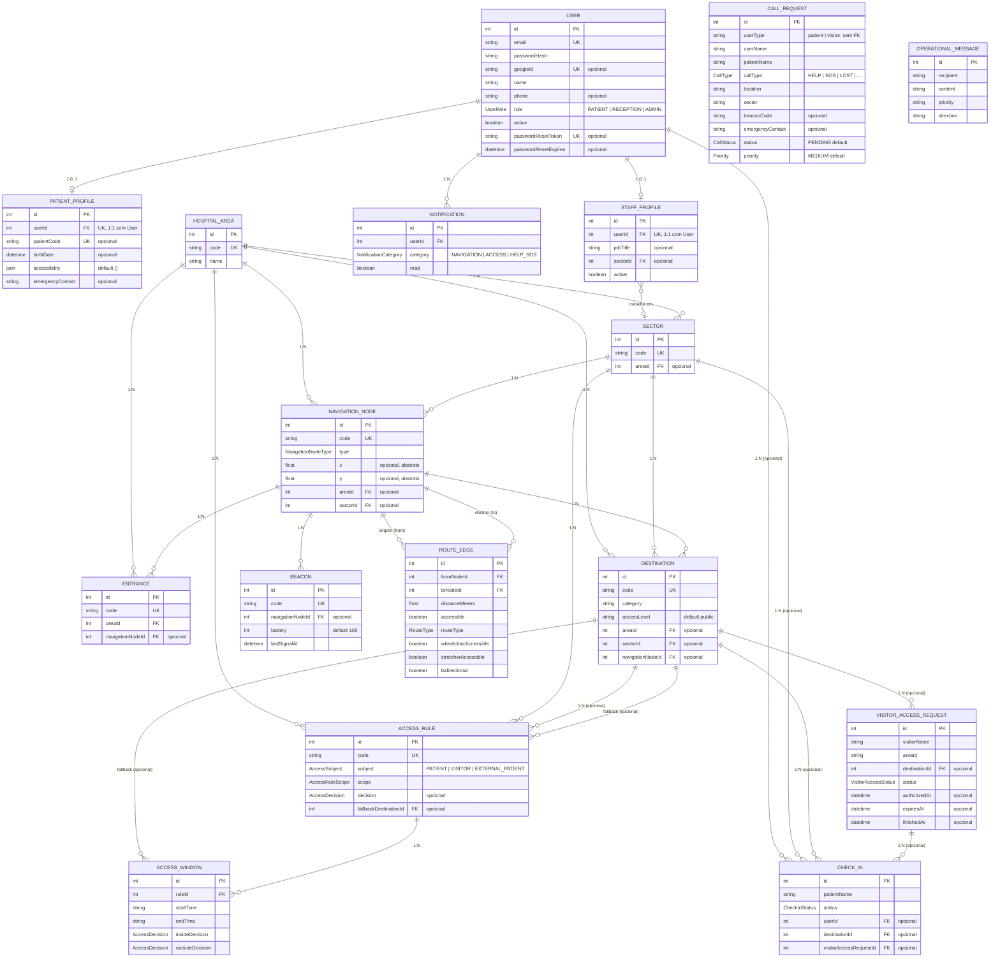

# Banco de Dados — Arquitetura e Modelagem

> Gerado a partir do schema real: `backend-nest/prisma/schema.prisma` (16 models, PostgreSQL via Prisma). Para o pipeline de navegação/acesso que usa estas tabelas, ver `docs/ARCHITECTURE.md`. Para os endpoints que leem/escrevem cada tabela, ver `docs/API.md`.

## 1. Visão geral

- **SGBD:** PostgreSQL. **ORM:** Prisma Client.
- **Convenção:** nomes de modelo/campo em `camelCase` no código, mapeados para `snake_case` nas tabelas reais via `@map`/`@@map` (ex.: `patientCode` → coluna `patient_code`, model `PatientProfile` → tabela `patient_profiles`).
- **Migrations:** incrementais em `backend-nest/prisma/migrations/`, aplicadas com `prisma migrate deploy` (produção) / `prisma migrate dev` (local).
- **Seed:** `backend-nest/prisma/seed.ts`, idempotente via `upsert` — pode rodar várias vezes sem duplicar dados.
- Produção (Render) está com o schema **desatualizado** em relação à branch atual (faltam a tabela `notifications` e colunas `google_id`/`password_reset_token`/`password_reset_expires` em `users` — ver nota de versão no `CLAUDE.md`).

## 2. Diagrama Entidade-Relacionamento

## 3. Domínios e decisões de modelagem

### 3.1 Identidade — `User`, `PatientProfile`, `StaffProfile`
- `User` concentra autenticação (e-mail, hash de senha, `googleId` opcional p/ login social, tokens de reset de senha) e é a única tabela com `role` (`PATIENT`/`RECEPTION`/`ADMIN`).
- `PatientProfile` e `StaffProfile` são **extensões 1:1 opcionais** de `User`, não um `role` por si — um `User` com `role = PATIENT` tem exatamente um `PatientProfile`; um `User` de recepção/admin não precisa de nenhum dos dois.
- `accessibility` em `PatientProfile` é `Json` livre (não uma tabela normalizada) porque o conjunto de flags é pequeno, muda com frequência e nunca é consultado por SQL — normalizar custaria mais do que ajuda.
- `StaffProfile` existe no schema mas **não tem tela no mobile** (confirma a regra de escopo: só Paciente e Visitante no app) — é suporte a dados pra quando/se o `web-admin` precisar listar equipe por setor.

### 3.2 Chamados — `CallRequest`
- **Decisão deliberada:** `CallRequest` não tem foreign key para `User`. Os dados de quem chamou (`userName`, `patientName`) são campos de texto soltos, duplicados no momento da criação.
- Motivo: SOS e "Preciso de ajuda" precisam funcionar mesmo pra quem está no fluxo de **acesso rápido sem conta** (`PatientQuickRegisterScreen`, `quick: true`) ou em modo offline (fallback de `navigationAdapter.js` gera um `CallRequest` local). Exigir FK pra `User` quebraria esse caso de uso central do app.
- Trade-off aceito: não há como consultar "todos os chamados deste paciente" por join; se isso vier a ser necessário, seria preciso adicionar um `userId` opcional sem remover os campos de texto (manter compatibilidade com chamados anônimos).

### 3.3 Grafo de navegação — `HospitalArea` → `Sector`/`Entrance`/`NavigationNode` → `RouteEdge`/`Destination`
- Modelo de grafo clássico: `NavigationNode` são os vértices (entradas, recepção, salas, corredores, elevadores, banheiros, saídas — `NavigationNodeType`); `RouteEdge` são as arestas, com peso (`distanceMeters`) e metadados de acessibilidade (`accessible`, `wheelchairAccessible`, `stretcherAccessible`, `routeType`).
- `RouteEdge.bidirectional` evita duplicar linha para corredores de dois sentidos; uma aresta unidirecional (`bidirectional: false`) só permite `from → to`.
- `@@unique([fromNodeId, toNodeId])` impede duas arestas diretas entre o mesmo par de nós no mesmo sentido.
- `x`/`y`/`z` em `NavigationNode` são coordenadas **abstratas** pro mapa esquemático (`MapScreen.js`), sem escala física validada — não confundir com coordenadas GPS reais (essas só existem em `ExternalRouteScreen.js`/`HowToGetScreen.js`, via `expo-location`, fora do banco).
- `Destination.accessLevel` (`public` por padrão) e as tabelas `AccessRule`/`AccessWindow` formam o motor de permissão: uma regra pode decidir `ALLOW`/`BLOCK`/`REQUIRE_AUTHORIZATION`/`REDIRECT_TO_RECEPTION` por área, setor, destino, categoria ou nível de acesso, com janelas de horário (`AccessWindow`) que podem inverter a decisão dentro/fora do horário.

### 3.4 Acesso de visitante — `VisitorAccessRequest`
- Guarda o pedido inteiro (quem, onde, destino pretendido, motivo, status) numa única tabela, sem normalizar em tabelas satélite — reflete que é um fluxo de vida curta (pedido → aprovação/negação → expiração/fim), não um cadastro permanente.
- `status` tem bem mais estados do que `CallRequest` (`PENDING, APPROVED, DENIED, CANCELED, EXPIRED, WAITING_AUTHORIZATION, AUTHORIZED, IN_ROUTE, ARRIVED, OFF_ROUTE, FINISHED`) porque acompanha o visitante do pedido até a saída do hospital, não só a triagem inicial.
- `destinationId` é opcional porque o pedido pode ser criado antes de um destino específico existir no grafo (ex.: "visitar paciente internado", sem destino de navegação formal ainda).

### 3.5 Beacon — `Beacon`
- Tabela deliberadamente simples (`code`, área, `navigationNodeId` opcional, `battery`, `lastSignalAt`) porque hoje é alimentada por simulação (`POST /beacons/detect` recebe um código arbitrário digitado/simulado, não um scan BLE real).
- `navigationNodeId` opcional existe porque um beacon pode ser cadastrado antes de ter um ponto de navegação associado (compatibilidade testada em `beacons.service.spec.ts`: "beacon conhecido sem node detecta").
- Preparada para o hardware real **Feasycom FSC-BP104D** (ver `docs/BLE_HARDWARE_VALIDATION.md`) — já existe uma linha de seed (`FSC-04-01`) vinculada à entrada Private, pronta pro dia em que o scanner real existir.

### 3.6 Notificações — `Notification`
- Única tabela com FK direta e obrigatória para `User` (sem suporte a notificação anônima — faz sentido, não existe "notificar alguém sem conta").
- `category` (`NAVIGATION`/`ACCESS`/`HELP_SOS`) é um enum fechado, não uma tabela de categorias — o conjunto é pequeno e estável.

## 4. Normalização e limitações conhecidas

- O schema está majoritariamente em 3FN, com duas fugas deliberadas (documentadas acima): `CallRequest` sem FK de usuário, e `accessibility` como `Json` em vez de tabela.
- `RouteEdge.distanceMeters` sem valor pode gerar "inconsistência controlada" (caso coberto no teste `edge sem distanceMeters e inconsistencia controlada`) — o sistema não trava, mas o resultado não é confiável; não há `NOT NULL` + `CHECK` no banco pra isso hoje.
- Seed atual (ver `docs/ARCHITECTURE.md`): 25 nós, 23 arestas (21 `CORRIDOR`, 2 `ELEVATOR`, nenhuma `RAMP`/`STAIRS`/`DOOR`/`TRANSFER` ainda), 21 destinos, 2 entradas, 6 beacons (5 simulados + `FSC-04-01`), 2 andares. `surgery-center` é isolado de propósito, pra representar destino restrito sem rota demonstrável.
